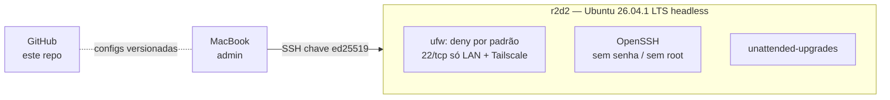

# homelab — r2d2

Laboratório de DevOps / Platform Engineering rodando em **um PC antigo**, sem custo de hardware ou nuvem.
Cada decisão técnica é registrada em [`docs/adr/`](docs/adr/) e cada fase tem critério de pronto verificável.

## Hardware

| Componente | Especificação | Observação |
|---|---|---|
| CPU | AMD Athlon 3000G — 2C/4T @ 3,5 GHz | **gargalo principal**: builds rodam fora (CI na nuvem) |
| RAM | 16 GB DDR4 3200 (2×8), **13 GB visíveis** (iGPU reserva o resto) | orçamento por serviço em [`docs/capacidade.md`](docs/capacidade.md) |
| Disco | SSD SATA 240 GB (Kingston A400, sem cache DRAM) | ext4 sem LVM, 179 GB livres |
| Placa-mãe | Biostar A320MH 2.0 (AM4) | upgrade futuro possível: Ryzen 5600G (depende de BIOS) |
| Rede | hoje Wi-Fi USB (Ethernet sem cabo); LAN 192.168.15.0/24 + Tailscale | IP fixo via reserva DHCP no roteador |

## Arquitetura (fase atual)

Arquitetura alvo, com todas as fases: [`docs/arquitetura.md`](docs/arquitetura.md).



## Roadmap

| Fase | Tema | Status |
|---|---|---|
| 1 | Linux base: SSH, usuários, firewall, rede, atualizações | 🚧 em andamento |
| 2 | Containers: Docker + Compose, volumes, health checks, limites | 🚧 em andamento |
| 3 | CI/CD: GitHub Actions → GHCR → deploy no r2d2 | ✅ concluída (2026-10-18) |
| 4 | IaC: Ansible (host) + Terraform (recursos externos) | ⏳ |
| 5 | Kubernetes: k3s single-node, Helm | ⏳ |
| 6 | Observabilidade e confiabilidade: Prometheus, Grafana, Loki, backups, falhas simuladas | ⏳ |
| 7 | Portfólio: diagramas, dashboards, postmortems, demo de deploy por commit | ⏳ |

## Estrutura

```
docs/adr/         decisões de arquitetura (por quê)
docs/runbooks/    procedimentos passo a passo (como)
docs/evidencias/  saídas de medição, prints, relatórios
host/             configuração do sistema operacional do r2d2
```
