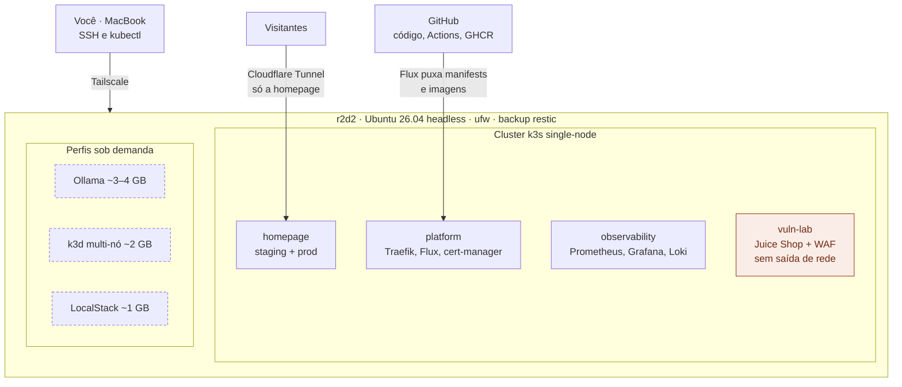
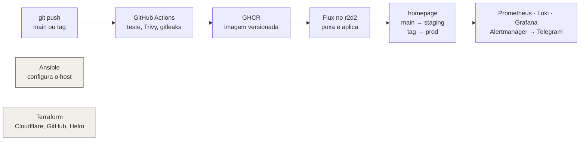

# Arquitetura alvo

Onde o lab quer chegar ao fim da Fase 7. Cada fase acende um pedaço; nada sobe antes de caber em
[`capacidade.md`](capacidade.md).

## Onde as coisas vivem

Regras:

- **vuln-lab nunca é exposto na internet.** Acesso só pelo Tailscale. NetworkPolicy bloqueia qualquer saída e o tráfego vindo de outros namespaces.
- Visitantes chegam **só** à homepage, por túnel de saída. Nenhuma porta é aberta no roteador.
- Perfis sob demanda não rodam ao mesmo tempo que build ou outro perfil pesado.

## Como uma mudança chega lá

- **Pull, não push.** O CI nunca recebe credencial do cluster. É o Flux, dentro do r2d2, que puxa o estado desejado do Git.
- **O build roda na nuvem.** A CPU de 2 núcleos do r2d2 só baixa e executa imagens prontas.
- **Infraestrutura é rodada por você.** Ansible e Terraform saem do Mac, com plano revisado antes de aplicar.

## Fases × componentes

| Fase | Acende |
|---|---|
| 1 | host: SSH, ufw, updates, Tailscale |
| 2 | Docker Compose: homepage e Juice Shop rodando como containers |
| 3 | GitHub Actions + GHCR + deploy automático (ainda em Compose) |
| 4 | Ansible reproduz o host; Terraform cria túnel/DNS e repositórios |
| 5 | migração Compose → k3s, namespaces, Helm, Flux |
| 6 | observability, WAF + painel de ataques, backup + restauração, falhas simuladas |
| 7 | polimento: postmortems, dashboards públicos, demo de commit → produção |
